# Break The Ice With Python

### A journey of 100+ simple yet interesting problems which are explained, solved, discussed in different pythonic ways

 

---------------------
## **Website & Autofill Extension**

Explore Zapply’s website and check out:

- Our Chrome extension, which autofills job applications in seconds.
- A dedicated job board featuring the latest openings across various roles.
- User accounts with multiple profiles for different resume types and roles.
- Job application tracking with streaks and commitment awards.

Experience an advanced career journey with us! 🚀

Sponsored by Zapply

---

## 🚀 Start here

- Every day has a few problems, each with a **question**, **hints** and **solutions** (the original Python 2 one and mine in Python 3).
- Try **3-5 problems a day**. After a month you will have solved 100+ problems.
- Prefer notebooks? Every day is also a [Jupyter notebook](notebooks/). Run it in your browser with the Binder or Deepnote button above.

---

## 📅 The 24 days

Follow the path stage by stage, or jump to any day. New here? Begin with <a href="Status/Day%201.md"><b>Day 1</b></a>.

 
<a href="Status/Day%201.md">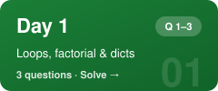</a>
<a href="Status/Day%202.md">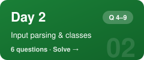</a>
<a href="Status/Day%203.md">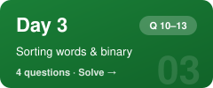</a>
 
<a href="Status/Day%204.md">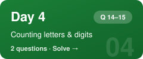</a>

<a href="Status/Day%206.md">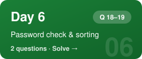</a>

 
<a href="Status/Day%207.md">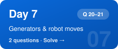</a>
<a href="Status/Day%208.md">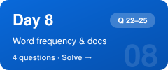</a>

 
<a href="Status/Day_10.md">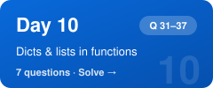</a>
<a href="Status/Day_11.md">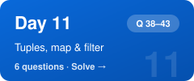</a>
<a href="Status/Day_12.md">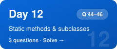</a>

 
<a href="Status/Day_13.md">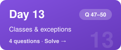</a>
<a href="Status/Day_14.md">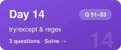</a>
<a href="Status/Day_15.md">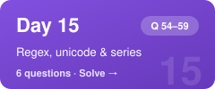</a>
 
<a href="Status/Day_16.md">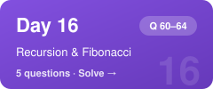</a>
<a href="Status/Day_17.md">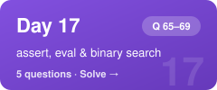</a>
<a href="Status/Day_18.md">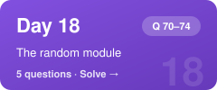</a>

 

<a href="Status/Day_20.md">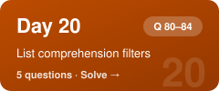</a>

 
<a href="Status/Day_22.md">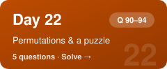</a>
<a href="Status/Day_23.md">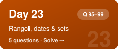</a>
<a href="Status/Day_24.md">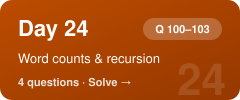</a>

⭐ If this helped you, a star helps other learners find it.

---

## ❤️ Sponsors

### Gold sponsors

<!-- 6 slots: 2 rows x 3 columns. Logo shown at 240x80 px (send 480x160 for sharp
     display), light + dark versions via <picture>, tagline up to 60 characters.
     Replace one placeholder cell per sponsor and link with ?ref=github-readme-gold. -->

<table>
<tr>
<td align="center"> One-line tagline</td>
<td align="center"> One-line tagline</td>
<td align="center"> One-line tagline</td>
</tr>
<tr>
<td align="center"> One-line tagline</td>
<td align="center"> One-line tagline</td>
<td align="center"> One-line tagline</td>
</tr>
</table>

### Silver sponsors

<!-- 8 slots: 2 rows x 4 columns. Logo shown at 160x50 px (send 320x100), no tagline.
     Replace one placeholder cell per sponsor and link with ?ref=github-readme-silver. -->

<table>
<tr>
<td align="center"><a href="SPONSORS.md">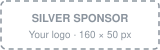</a></td>
<td align="center"></td>
<td align="center"></td>
<td align="center"></td>
</tr>
<tr>
<td align="center"></td>
<td align="center"></td>
<td align="center"></td>
<td align="center"></td>
</tr>
</table>

<b><a href="SPONSORS.md">Become a sponsor →</a></b> Get in touch: <a href="mailto:rctushar07@gmail.com?subject=Sponsorship%20-%20Break%20The%20Ice%20With%20Python">rctushar07@gmail.com</a>

---

## About

The exercise texts in this repository were collected from [zhiwehu](https://github.com/zhiwehu/Python-programming-exercises)'s GitHub account. I collected them to practise and solve all of them in Python, and I'm adding more over time. The main author's solutions are in Python 2 and mine are in Python 3. I also explain the code and give my opinion on a problem where it helps.

Found a mistake or have an idea? Join the [discussion](https://github.com/darkprinx/100-plus-Python-programming-exercises-extended/issues/3).

## Contributing

Want to add your own solution or fix something? See [CONTRIBUTING.md](CONTRIBUTING.md) for a quick guide, and [CONTRIBUTORS.md](CONTRIBUTORS.md) for everyone who has contributed a solution through a merged pull request.

## Acknowledgements

A big thanks to [apurvmishra99](https://github.com/apurvmishra99) for cleaning up the formatting of all the Day files, fixing errors, renaming variables to follow PEP 8, and adding a [Jupyter notebook](notebooks/) for each of the 24 days.
