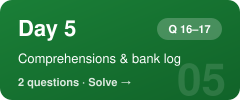

<!-- Day page sponsor slot: empty, so nothing is shown. When sold, add the line below
     right under this comment. Logo 120x40 px (send 240x80), text up to 60 characters:
     <p align="right"><sub>Sponsored</sub><br><a href="URL?ref=github-day-04"></a>&nbsp; <a href="URL?ref=github-day-04">One-line message →</a></p> -->

<!-- day-nav:top -->
<p align="center"><a href="Day%203.md">← Day 3</a> &nbsp;·&nbsp; <a href="../README.md#days">All 24 days</a> &nbsp;·&nbsp; <a href="Day%205.md">Day 5 →</a></p>
<!-- /day-nav:top -->

# Question 14

### **Question:**

> **_Write a program that accepts a sentence and calculate the number of upper case letters and lower case letters._**

> **_Suppose the following input is supplied to the program:_**

```
Hello world!
```

> **_Then, the output should be:_**

```
UPPER CASE 1
LOWER CASE 9
```

---

### Hints:

> **_In case of input data being supplied to the question, it should be assumed to be a console input._**

---

**Main author's Solution: Python 2**

```python
s = raw_input()
d = {"UPPER CASE":0, "LOWER CASE":0}
for c in s:
    if c.isupper():
        d["UPPER CASE"]+=1
    elif c.islower():
        d["LOWER CASE"]+=1
    else:
        pass
print "UPPER CASE", d["UPPER CASE"]
print "LOWER CASE", d["LOWER CASE"]
```

---

**My Solution: Python 3**

```python
word = input()
upper,lower = 0,0

for i in word:
    if 'a'<=i and i<='z' :
        lower+=1
    if 'A'<=i and i<='Z':
        upper+=1

print("UPPER CASE {0}\nLOWER CASE {1}".format(upper,lower))
```

**OR**

```python
word = input()
upper,lower = 0,0

for i in word:
        lower+=i.islower()
        upper+=i.isupper()

print("UPPER CASE {0}\nLOWER CASE {1}".format(upper,lower))
```

**OR**

```python
word = input()
upper = sum(1 for i in word if i.isupper())           # sum function cumulatively sum up 1's if the condition is True
lower = sum(1 for i in word if i.islower())

print("UPPER CASE {0}\nLOWER CASE {1}".format(upper,lower))
```

**OR**

```python
# solution by Amitewu

string = input("Enter the sentense")
upper = 0
lower = 0
for x in string:
    if x.isupper() == True:
        upper += 1
    if x.islower() == True:
        lower += 1

print("UPPER CASE: ", upper)
print("LOWER CASE: ", lower)
```

**OR**

```python
# solution by VK

my_input = input('Enter data:\n')

def summ_upper_low(some_str):
    upper_case = 0
    lower_case = 0
    for i in some_str:
        if i.isalpha() and i.islower():
            lower_case += 1
        elif i.isalpha() and i.isupper():
            upper_case += 1
    print(f'Upper case {upper_case} \nLower case {lower_case}')

summ_upper_low(my_input)
```

---

# Question 15

### **Question:**

> **_Write a program that computes the value of a+aa+aaa+aaaa with a given digit as the value of a._**

> **_Suppose the following input is supplied to the program:_**

```
9
```

> **_Then, the output should be:_**

```
11106
```

---

### Hints:

> **_In case of input data being supplied to the question, it should be assumed to be a console input._**

---

**Main author's Solution: Python 2**

```python
a = raw_input()
n1 = int( "%s" % a )
n2 = int( "%s%s" % (a,a) )
n3 = int( "%s%s%s" % (a,a,a) )
n4 = int( "%s%s%s%s" % (a,a,a,a) )
print n1+n2+n3+n4
```

---

**My Solution: Python 3**

```python
a = input()
total,tmp = 0,str()        # initialing an integer and empty string

for i in range(4):
    tmp+=a               # concatenating 'a' to 'tmp'
    total+=int(tmp)      # converting string type to integer type

print(total)
```

**OR**

```python
a = input()
total = int(a) + int(2*a) + int(3*a) + int(4*a)  # N*a=Na, for example  a="23", 2*a="2323",3*a="232323"
print(total)
```
---
```python
'''Solution by: ChichiLovesDonkeys
'''
from functools import reduce
x = input('please enter a digit:')
print(reduce(lambda x, y: int(x) + int(y), [x*i for i in range(1,5)]))
```
---
```python
'''Solution by: lcastrooliveira
'''
def question_15(string_digit):
    return sum(int(string_digit * n) for n in range(1, 5))

inp = input()
print(question_15(inp))
```
---
```python
'''Solution by: apenam7
'''
a = input()
print(sum(int(i*a) for i in range(1,5)))
```
---
# Solution by Samosanction
num = int(input('input a number: '))
sum = num + (num * 11) + (num * 111) + (num * 1111)
print(sum)

<!-- day-nav:bottom -->
<p align="center">
<sub><b>UP NEXT</b></sub><br>
<a href="Day%205.md"></a><br>
<a href="Day%203.md">← Day 3</a> &nbsp;·&nbsp; <a href="../README.md#days">All 24 days</a>
</p>
<!-- /day-nav:bottom -->

[**_Discussion_**](https://github.com/darkprinx/100-plus-Python-programming-exercises-extended/issues/3)
