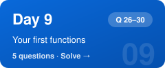

<!-- Day page sponsor slot: empty, so nothing is shown. When sold, add the line below
     right under this comment. Logo 120x40 px (send 240x80), text up to 60 characters:
     <p align="right"><sub>Sponsored</sub><br><a href="URL?ref=github-day-08"></a>&nbsp; <a href="URL?ref=github-day-08">One-line message →</a></p> -->

<!-- day-nav:top -->
<p align="center"><a href="Day%207.md">← Day 7</a> &nbsp;·&nbsp; <a href="../README.md#days">All 24 days</a> &nbsp;·&nbsp; <a href="Day%209.md">Day 9 →</a></p>
<!-- /day-nav:top -->

# Question 22

### **Question:**

> **_Write a program to compute the frequency of the words from the input. The output should output after sorting the key alphanumerically._**

> **_Suppose the following input is supplied to the program:_**

```
New to Python or choosing between Python 2 and Python 3? Read Python 2 or Python 3.
```

> **_Then, the output should be:_**

```
2:2
3.:1
3?:1
New:1
Python:5
Read:1
and:1
between:1
choosing:1
or:2
to:1
```

---

### Hints

> **_In case of input data being supplied to the question, it should be assumed to be a console input._**

---

<details markdown="1">
<summary><b>💡 Show solutions</b> (try it yourself first!)</summary>

**Main author's Solution: Python 2**

```python
freq = {}   # frequency of words in text
line = raw_input()
for word in line.split():
    freq[word] = freq.get(word,0)+1

words = freq.keys()
words.sort()

for w in words:
    print "%s:%d" % (w,freq[w])
```

---

**My Solution: Python 3**

```python
ss = input().split()
word = sorted(set(ss))     # split words are stored and sorted as a set

for i in word:
    print("{0}:{1}".format(i,ss.count(i)))
```

**OR**

```python
ss = input().split()
dict = {}
for i in ss:
    i = dict.setdefault(i,ss.count(i))    # setdefault() function takes key & value to set it as dictionary.

dict = sorted(dict.items())               # items() function returns both key & value of dictionary as a list
                                          # and then sorted. The sort by default occurs in order of 1st -> 2nd key
for i in dict:
    print("%s:%d"%(i[0],i[1]))
```

**OR**

```python
ss = input().split()
dict = {i:ss.count(i) for i in ss}     # sets dictionary as i-> split word & ss.count(i) -> total occurrence of i in ss
dict = sorted(dict.items())            # items() function returns both key & value of dictionary as a list
                                       # and then sorted. The sort by default occurs in order of 1st -> 2nd key
for i in dict:
    print("%s:%d"%(i[0],i[1]))
```

**OR**

```python
from collections import Counter

ss = input().split()
ss = Counter(ss)         # returns key & frequency as a dictionary
ss = sorted(ss.items())  # returns as a tuple list

for i in ss:
    print("%s:%d"%(i[0],i[1]))
```

**Solution by: AnjanKumarG**

```python
from pprint import pprint
p=input().split()
pprint({i:p.count(i) for i in p})
```


</details>

---

# Question 23

### **Question:**

> **_Write a method which can calculate square value of number_**

---

### Hints:

```
Using the ** operator which can be written as n**p where means n^p
```

---

<details markdown="1">
<summary><b>💡 Show solutions</b> (try it yourself first!)</summary>

**Main author's Solution: Python 2**

```python
def square(num):
    return num ** 2

print square(2)
print square(3)
```

---

**My Solution: Python 3**

```python
n=int(input())
print(n**2)
```


</details>

---

# Question 24

### **Question:**

> **_Python has many built-in functions, and if you do not know how to use it, you can read document online or find some books. But Python has a built-in document function for every built-in functions._**

> **_Please write a program to print some Python built-in functions documents, such as abs(), int(), raw_input()_**

> **_And add document for your own function_**

### Hints:

```
The built-in document method is __doc__
```

---

<details markdown="1">
<summary><b>💡 Show solutions</b> (try it yourself first!)</summary>

**Main author's Solution: Python 2**

```python
print abs.__doc__
print int.__doc__
print raw_input.__doc__

def square(num):
    '''Return the square value of the input number.

    The input number must be integer.
    '''
    return num ** 2

print square(2)
print square.__doc__
```

---

**My Solution: Python 3**

```python
print(str.__doc__)
print(sorted.__doc__)

def pow(n,p):
    '''
    param n: This is any integer number
    param p: This is power over n
    return:  n to the power p = n^p
    '''

    return n**p

print(pow(3,4))
print(pow.__doc__)
```


</details>

---

# Question 25

### **Question:**

> **_Define a class, which have a class parameter and have a same instance parameter._**

---

### Hints:

```
Define an instance parameter, need add it in __init__ method.You can init an object with construct parameter or set the value later
```

---

<details markdown="1">
<summary><b>💡 Show solutions</b> (try it yourself first!)</summary>

**Main author's Solution: Python 2**

```python
class Person:
    # Define the class parameter "name"
    name = "Person"

    def __init__(self, name = None):
        # self.name is the instance parameter
        self.name = name

jeffrey = Person("Jeffrey")
print "%s name is %s" % (Person.name, jeffrey.name)

nico = Person()
nico.name = "Nico"
print "%s name is %s" % (Person.name, nico.name)
```

---

**My Solution: Python 3**

```python
class Car:
    name = "Car"

    def __init__(self,name = None):
        self.name = name

honda=Car("Honda")
print("%s name is %s"%(Car.name,honda.name))

toyota=Car()
toyota.name="Toyota"
print("%s name is %s"%(Car.name,toyota.name))
```


</details>

---

<!-- day-nav:bottom -->
<p align="center">
<sub><b>UP NEXT</b></sub><br>
<a href="Day%209.md"></a><br>
<a href="Day%207.md">← Day 7</a> &nbsp;·&nbsp; <a href="../README.md#days">All 24 days</a>
</p>
<!-- /day-nav:bottom -->

[**_Discussion_**](https://github.com/darkprinx/100-plus-Python-programming-exercises-extended/issues/3)
