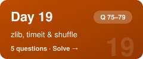

<!-- Day page sponsor slot: logo 120x40 px (send 240x80) + one line of text up to
     60 characters. When sold, replace the <p> below with:
     <p align="right"><sub>Sponsored</sub><br><a href="URL?ref=github-day-18"></a>&nbsp; <a href="URL?ref=github-day-18">One-line message →</a></p> -->
<p align="right"><a href="../SPONSORS.md"></a></p>

<!-- day-nav:top -->
<p align="center"><a href="Day_17.md">← Day 17</a> &nbsp;·&nbsp; <a href="../README.md#days">All 24 days</a> &nbsp;·&nbsp; <a href="Day_19.md">Day 19 →</a></p>
<!-- /day-nav:top -->

# Question 70

### **Question**

> **_Please write a program to output a random even number between 0 and 10 inclusive using random module and list comprehension._**

---

### Hints

> **_Use random.choice() to a random element from a list._**

---

**Main author's Solution: Python 2**

```python
li = [2,4,6,8]
import random
print random.choice([i for i in range(11) if i%2==0])
```

---

**My Solution: Python 3**

```python
import random
resp = [i for i in range(0,11,2)]
print(random.choice(resp))
```

---

# Question 71

### **Question**

> **_Please write a program to output a random number, which is divisible by 5 and 7, between 10 and 150 inclusive using random module and list comprehension._**

---

### Hints

> **_Use random.choice() to a random element from a list._**

---

**Main author's Solution: Python 2**

```python
import random
print random.choice([i for i in range(10,151) if i%5==0 and i%7==0])
```

---

**My Solution: Python 3**

```python
import random
resp = [i for i in range(10,151) if i % 35 == 0 ]
print(random.choice(resp))
```

---

# Question 72

### **Question**

> **_Please write a program to generate a list with 5 random numbers between 100 and 200 inclusive._**

---

### Hints

> **_Use random.sample() to generate a list of random values._**

---

**Main author's Solution: Python 2**

```python

import random
print random.sample(range(100,201), 5)
```

---

**My Solution: Python 3**

```python
import random
resp = random.sample(range(100,201),5)
print(resp)
```

---

# Question 73

### **Question**

> **_Please write a program to randomly generate a list with 5 even numbers between 100 and 200 inclusive._**

---

### Hints

> **_Use random.sample() to generate a list of random values._**

---

**Main author's Solution: Python 2**

```python

import random
print random.sample([i for i in range(100,201) if i%2==0], 5)

```

---

**My Solution: Python 3**

```python
import random
resp = random.sample(range(100,201,2),5)
print(resp)
```

---

# Question 74

### **Question**

> **_Please write a program to randomly generate a list with 5 numbers, which are divisible by 5 and 7 , between 1 and 1000 inclusive._**

---

### Hints

> **_Use random.sample() to generate a list of random values._**

---

**Main author's Solution: Python 2**

```python

import random
print random.sample([i for i in range(1,1001) if i%5==0 and i%7==0], 5)
```

---

**My Solution: Python 3**

```python
import random
lst = [i for i in range(1,1001) if i%35 == 0]
resp = random.sample(lst,5)
print(resp)
```

---

<!-- day-nav:bottom -->
<p align="center">
<sub><b>UP NEXT</b></sub><br>
<a href="Day_19.md"></a><br>
<a href="Day_17.md">← Day 17</a> &nbsp;·&nbsp; <a href="../README.md#days">All 24 days</a>
</p>
<!-- /day-nav:bottom -->

[**_Discussion_**](https://github.com/darkprinx/100-plus-Python-programming-exercises-extended/issues/3)
