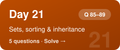

<!-- Day page sponsor slot: empty, so nothing is shown. When sold, add the line below
     right under this comment. Logo 120x40 px (send 240x80), text up to 60 characters:
     <p align="right"><sub>Sponsored</sub><br><a href="URL?ref=github-day-20"></a>&nbsp; <a href="URL?ref=github-day-20">One-line message →</a></p> -->

<!-- day-nav:top -->
<p align="center"><a href="Day_19.md">← Day 19</a> &nbsp;·&nbsp; <a href="../README.md#days">All 24 days</a> &nbsp;·&nbsp; <a href="Day_21.md">Day 21 →</a></p>
<!-- /day-nav:top -->

# Question 80

### **Question**

> **_Please write a program to print the list after removing even numbers in [5,6,77,45,22,12,24]._**

---

### Hints

> **_Use list comprehension to delete a bunch of element from a list._**

---

**Main author's Solution: Python 2**

```python
li = [5,6,77,45,22,12,24]
li = [x for x in li if x%2!=0]
print li
```

---

**My Solution: Python 3**

```python
def isEven(n):
    return n%2!=0

li = [5,6,77,45,22,12,24]
lst = list(filter(isEven,li))
print(lst)
```

**OR**

```python
li = [5,6,77,45,22,12,24]
lst = list(filter(lambda n:n%2!=0,li))
print(lst)
```

---

# Question 81

### **Question**

> **_By using list comprehension, please write a program to print the list after removing numbers which are divisible by 5 and 7 in [12,24,35,70,88,120,155]._**

---

### Hints

> **_Use list comprehension to delete a bunch of element from a list._**

---

**Main author's Solution: Python 2**

```python
li = [12,24,35,70,88,120,155]
li = [x for x in li if x%5!=0 and x%7!=0]
print li
```

---

**My Solution: Python 3**

```python
li = [12,24,35,70,88,120,155]
li = [x for x in li if x % 35!=0]
print(li)
```

---

# Question 82

### **Question**

> **_By using list comprehension, please write a program to print the list after removing the 0th, 2nd, 4th,6th numbers in [12,24,35,70,88,120,155]._**

---

### Hints

> **_Use list comprehension to delete a bunch of element from a list.
> Use enumerate() to get (index, value) tuple._**

---

**Main author's Solution: Python 2**

```python

li = [12,24,35,70,88,120,155]
li = [x for (i,x) in enumerate(li) if i%2 != 0 and i <= 6]
print li
```

---

**My Solution: Python 3**

```python
li = [12,24,35,70,88,120,155]
li = [li[i] for i in range(len(li)) if i%2 != 0 and i <= 6]
print(li)
```
---
```python
'''Solution by: popomaticbubble
'''
orig_lst = [12,24,35,70,88,120,155]
indices = [0, 2, 4, 6]

new_list = [i for (j, i) in enumerate(orig_lst) if j not in indices]
print(new_list)
```
---

# Question 83

### **Question**

> **_By using list comprehension, please write a program to print the list after removing the 2nd - 4th numbers in [12,24,35,70,88,120,155]._**

---

### Hints

> **_Use list comprehension to delete a bunch of element from a list.
> Use enumerate() to get (index, value) tuple._**

---

**Main author's Solution: Python 2**

```python

li = [12,24,35,70,88,120,155]
li = [x for (i,x) in enumerate(li) if i<3 or 4<i]
print li

```
---
**My Solution: Python 3**

```python
#to be written
li = [12,24,35,70,88,120,155]
li = [li[i] for i in range(len(li)) if i < 3 or i > 4]
print(li)
```
---
```python
"""Solution by: popomaticbubble
"""
orig_list = [12,24,35,70,88,120,155]
new_list = [i for (j, i) in enumerate(orig_list) if j not in range(1,4)]
print(new_list)
```
---
```python
"""Solution by: saxenaharsh24
"""
lst = [12,24,35,70,88,120,155]
print([i for i in lst if lst.index(i) not in range(2,5)])
```
---
# Question 84

### **Question**

> **_By using list comprehension, please write a program generate a 3\*5\*8 3D array whose each element is 0._**

---

### Hints

> **_Use list comprehension to make an array._**

---

**Solution:**

```python
array = [[ [0 for col in range(8)] for col in range(5)] for row in range(3)]
print array
```

---

<!-- day-nav:bottom -->
<p align="center">
<sub><b>UP NEXT</b></sub><br>
<a href="Day_21.md"></a><br>
<a href="Day_19.md">← Day 19</a> &nbsp;·&nbsp; <a href="../README.md#days">All 24 days</a>
</p>
<!-- /day-nav:bottom -->

[**_Discussion_**](https://github.com/darkprinx/100-plus-Python-programming-exercises-extended/issues/3)
