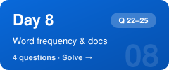

> **Preview for sponsors.** This is how a Day page looks with a sponsor. It's a copy of [Day 7](../Status/Day%207.md) with the slot marked; the real pages show nothing in this spot until it is sold. [Back to sponsorship details](../SPONSORS.md)

---

<p align="right"><a href="../SPONSORS.md"></a></p>

<p align="center"><a href="../Status/Day%206.md">← Day 6</a> &nbsp;·&nbsp; <a href="../README.md#days">All 24 days</a> &nbsp;·&nbsp; <a href="../Status/Day%208.md">Day 8 →</a></p>

# Question 20

### **Question:**

> **_Define a class with a generator which can iterate the numbers, which are divisible by 7, between a given range 0 and n._**

> **_Suppose the following input is supplied to the program:_**

```
7
```

> **_Then, the output should be:_**

```
0
7
14
```
---

### Hints:

> **_Consider use class, function and comprehension._**

---

<p align="center"><i>… solutions and explanations for the day's questions …</i></p>

---

<p align="center">
<sub><b>UP NEXT</b></sub><br>
<a href="../Status/Day%208.md"></a><br>
<a href="../Status/Day%206.md">← Day 6</a> &nbsp;·&nbsp; <a href="../README.md#days">All 24 days</a>
</p>
